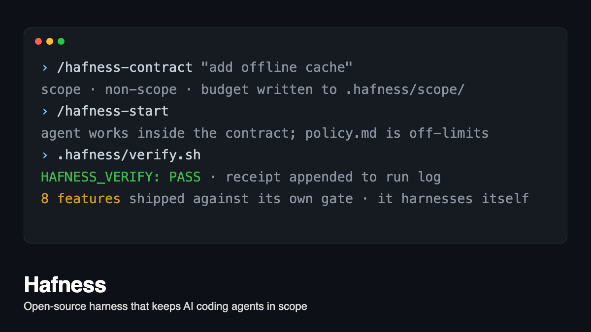
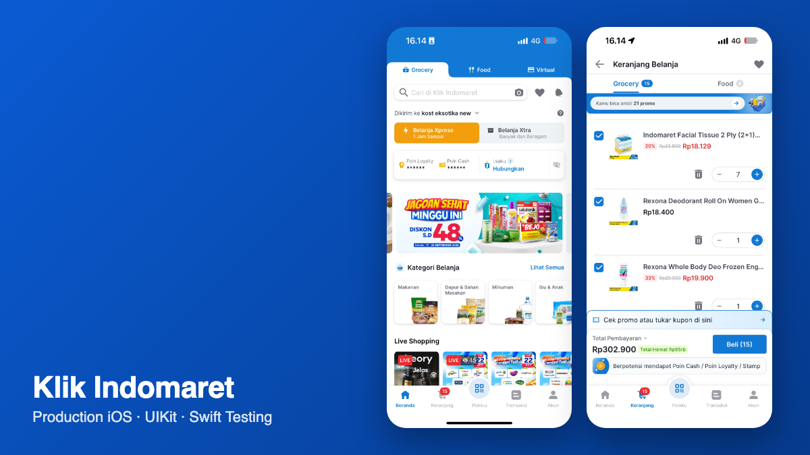
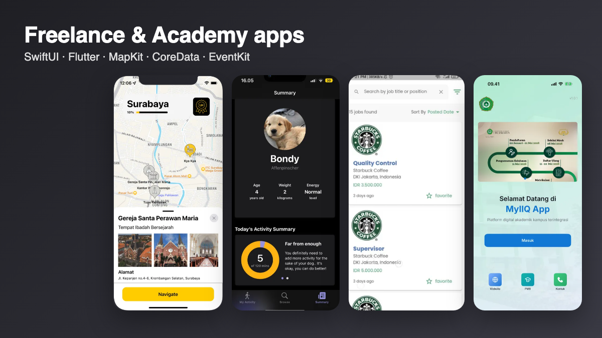
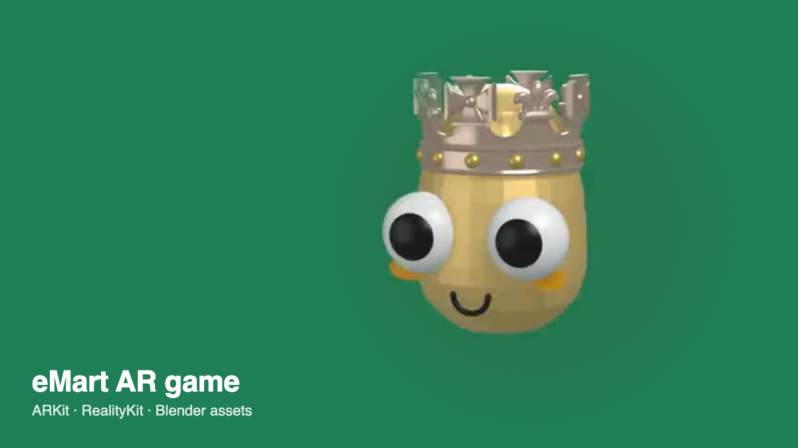

<table><tr><td width="9999">

### 👋 Hey, I'm Hafshy

iOS Developer at **EDTS** (Jakarta) · Co-founder of **WonderJack**, an iPad learning game for dyslexic kids (ASEAN Digital Awards 2025, Silver). 
I ship production iOS with a spec-driven agentic workflow (app-wide test coverage 0 → 49%) and build [**Hafness**](https://github.com/hafshy/hafness), a harness that keeps AI coding agents in scope.

  
  
  
  

**languages** 

**apple** 

**agents / ai** 

**backend / infra** 

</td></tr></table>
